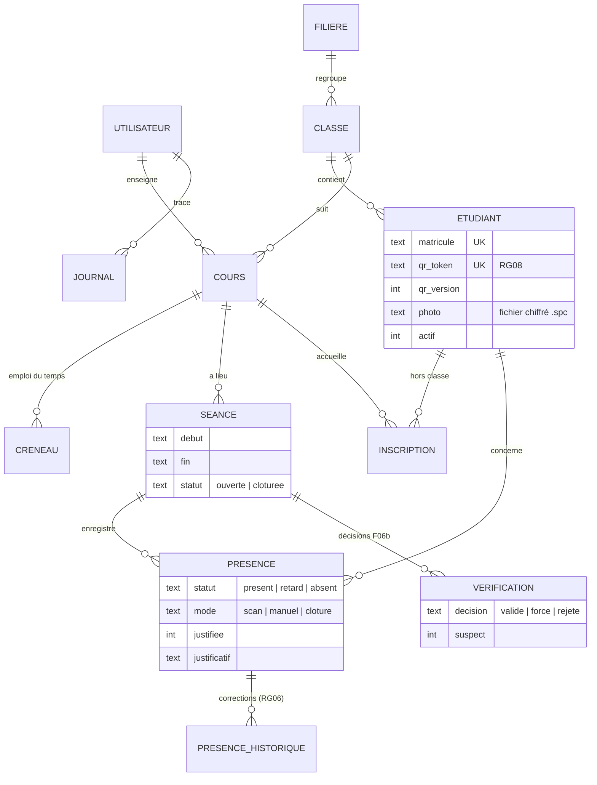

# Documentation technique de SmartPresence

## 1. Architecture

L'application est découpée en trois couches. Chaque couche ne dépend que de celles du dessous.

```
ui/    Interface PySide6        ── appelle ──▶  core/   Logique métier   ── appelle ──▶  data/   SQLCipher
       (thème, fenêtres, scan,                   (règles RG01-RG08,                    (requêtes, transactions,
        écrans de sécurité)                       droits, rapports, audit)               chiffrement, migrations)
```

- **`data/`** ne contient aucune règle de gestion. Toutes les requêtes SQL sont dans
  `repositories.py`, sauf les agrégations des rapports (`core/rapports.py`).
- **`core/`** ne dépend jamais de Qt, sauf `lecture_qr.py` qui dépend d'OpenCV. Les règles
  de gestion y sont testées sans interface.
- **`ui/`** n'accède jamais à SQLite directement. Chaque erreur métier (`ErreurMetier`)
  porte un message en français, affiché tel quel.
- **`app.py`** assemble les services autour d'une même `Database`. L'heure courante est
  injectée (`Horloge`), ce qui rend les tests de retard et de clôture déterministes.

| Module | Rôle | Exigences |
|---|---|---|
| `core/auth.py` | Connexion bcrypt, blocage progressif, politique de mots de passe, `exiger_role` | F01 |
| `core/securite.py` | Validation des textes et des fichiers fournis par les utilisateurs | |
| `core/audit.py` | Vérification de la chaîne d'empreintes du journal | F13 |
| `data/chiffrement.py` | Clé maîtresse (DPAPI), code de récupération, fichiers AES-256-GCM | |
| `data/database.py` | Connexion SQLCipher, migrations, déclencheurs d'audit, migration des données en clair | |
| `core/referentiel.py` | Étudiants, photos, filières, classes, cours, créneaux, inscriptions | F02, F03, RG08 |
| `core/import_etudiants.py` | Import CSV/Excel en deux temps | F02 |
| `core/qr.py`, `core/cartes.py` | Contenu des QR codes, cartes PDF | F04, RG08 |
| `core/attendance.py` | Séances, scan, vérification, pointage manuel, clôture, taux | F05 à F10, RG01 à RG07 |
| `core/lecture_qr.py` | Décodage OpenCV, anti-rebond | F06 |
| `core/rapports.py`, `core/exports.py` | Rapports, alertes, Excel, PDF | F09, F11, F12 |
| `core/parametres.py`, `core/sauvegarde.py` | Paramètres, sauvegarde et restauration | F14 |
| `ui/verification.py` | Écran anti-fraude (Entrée / Échap) | F06b |
| `ui/scan.py` | Thread webcam, champ du lecteur USB | F06 |
| `ui/theme.py`, `ui/icones.py` | Jetons de couleur (clair / sombre), typographie, feuille de style, icônes SVG | |
| `ui/animation.py` | Transitions d'écran, indicateur de navigation, secousse, fondus ; désactivées si Windows coupe les animations | |
| `ui/securite.py` | Mot de passe, code de récupération, ré-authentification, verrouillage | |
| `ui/aide.py` | Aide intégrée (F1) : sujets par écran et par rôle, ouverture du manuel, des guides et de la FAQ | |

## 2. Modèle de données



Le schéma complet et commenté se trouve dans `smartpresence/data/schema.sql`. Quelques
garanties sont assurées directement par la base :

- **`UNIQUE (seance_id, etudiant_id)`** : un étudiant ne peut être pointé qu'une fois par
  séance (RG01), même si deux validations arrivent en même temps.
- **Unicité du matricule et du jeton QR** (RG08).
- **`PRAGMA foreign_keys = ON`, mode WAL, `synchronous = FULL`** : chaque pointage validé
  est écrit immédiatement et survit à une fermeture brutale.

**Évolutions du schéma.** `PRAGMA user_version` donne la version du schéma (5). `Database`
applique les migrations de `MIGRATIONS` aux bases existantes ; les ajouts de colonnes sont
rejouables. Une base neuve reçoit directement `schema.sql`, qui décrit toujours la dernière
version. Une base en clair (avant la version 1.1) est convertie en base SQLCipher à
l'ouverture, ses photos et justificatifs sont chiffrés, puis les copies en clair supprimées.

**Tables d'audit en ajout seul.** Des déclencheurs refusent toute modification ou suppression
dans `journal`, `presence_historique` et `verification`. Chaque entrée du journal reçoit
une empreinte HMAC-SHA256 chaînée, calculée par la fonction SQL `sp_empreinte` que
l'application enregistre sur la connexion.

## 3. Règles de gestion

| Règle | Implémentation | Tests |
|---|---|---|
| RG01 Un seul pointage par séance | `_controler` → `DEJA_POINTE`, contrainte `UNIQUE` | `test_rg01_*` |
| RG02 Hors cours : alerte, forçage par l'enseignant du cours | `valider(forcer=True)`, rôle et propriétaire vérifiés | `test_rg02_*`, `test_hors_cours_*` |
| RG03 Pas de photo → pas de validation | `PHOTO_MANQUANTE` bloquante, pointage manuel proposé | `test_rg03_*` |
| RG04 Retard après la tolérance | `calculer_statut` (strictement après début + tolérance) | `test_rg04_*` |
| RG05 Clôture → absents | `_cloturer`, aussi automatique (`cloturer_seances_echues`) | `test_rg05_*` |
| RG06 Correction tracée | `pointage_manuel` → `presence_historique` + journal | `test_rg06_*` |
| RG07 Taux d'assiduité | `calculer_taux`, partagé par le service et les rapports | `test_rg07_*`, `test_par_etudiant_coherent_avec_rg07` |
| RG08 Carte régénérée = ancienne invalidée | `qr_token` aléatoire dans le QR, `regenerer_carte` | `test_rg08_*` |

## 4. QR code et scan

- **Contenu du QR code :** `SP-<matricule>-<jeton>`. Le jeton fait 10 caractères tirés de
  `ABCDEFGHJKLMNPQRSTUVWXYZ23456789` (sans 0/O ni 1/I), généré par `secrets`. Il n'utilise
  que le mode alphanumérique des QR codes, transmis sans erreur par un lecteur USB en AZERTY.
- **Webcam :** `LecteurWebcam` (QThread) lit la caméra avec DirectShow, publie chaque image
  et décode avec `QRCodeDetectorAruco`. En cas d'échec, un second essai est fait sur une
  image au contraste renforcé (CLAHE) et agrandie. `AntiRebond` ignore une carte relue
  pendant 3 s, et le décodage est suspendu pendant la vérification.
- **Lecteur USB :** `ChampLecteurUSB` émet le contenu à la touche Entrée. Dans l'écran de
  vérification, une saisie clavier dans les 600 ms qui précèdent Entrée est traitée comme
  un scan parasite : cet Entrée ne valide pas.

## 5. Sécurité

Voir [securite.md](securite.md) : menaces couvertes, chiffrement au repos (SQLCipher,
AES-256-GCM, DPAPI), authentification (bcrypt, blocage progressif, politique, mots de passe
provisoires), sessions (verrouillage, ré-authentification), journal infalsifiable, validation
des entrées, dépendances figées et auditées, risques résiduels.

La hiérarchie des clés :

```
clé maîtresse (256 bits, aléatoire) ── DPAPI (compte Windows) ──▶ cle.protegee
        │                            └─ code de récupération (14 × 4 caractères, avec somme de contrôle)
        └─ HKDF-SHA256 ─┬─ « base-sqlcipher » ──▶ PRAGMA key de la base
                        ├─ « fichiers »       ──▶ AES-256-GCM des photos et justificatifs
                        ├─ « journal-hmac »   ──▶ empreintes chaînées du journal
                        └─ « empreinte »      ──▶ identifiant public de la clé (sauvegardes)
```

## 6. Tests

```bash
.venv\Scripts\python -m pytest
```

287 tests, en deux à trois minutes. Ils se répartissent ainsi :

| Fichier | Contenu |
|---|---|
| `test_regles_gestion.py` | RG01 à RG08, scénarios de recette, état d'une séance |
| `test_qr_auth_persistance.py` | Format QR, authentification, persistance après fermeture brutale |
| `test_referentiel.py`, `test_import.py` | Gestion des étudiants, classes, cours ; import CSV/Excel |
| `test_cartes.py` | PDF des cartes ; chaque QR code est rendu à 300 dpi puis décodé |
| `test_scan.py` | Taux de lecture sur images de webcam simulées, thread webcam (fausse caméra), clavier de l'écran de vérification, déroulé d'une séance |
| `test_rapports.py` | Rapports, exports, **performance avec 5 000 étudiants** |
| `test_administration.py` | Paramètres, sauvegarde/restauration, justificatifs, écrans |
| `test_securite.py` | Données illisibles sur le disque, photos échangées, clé absente et code de récupération, migration des données en clair, journal infalsifiable, blocage des comptes, politique de mots de passe, injections (Excel, HTML), images piégées, archives piégées, verrouillage, blocage des identifiants inconnus, frein global, session revérifiée, QR codes étrangers, restauration interrompue, presse-papiers |
| `test_ui.py` | Écrans de gestion (sans affichage) |
| `test_aide.py` | Aide intégrée : un sujet par écran de chaque rôle, F1 contextuel, documents livrés |

Les tests d'interface tournent sans écran (`QT_QPA_PLATFORM=offscreen`) et sans son.

## 7. Construction de l'installateur

```powershell
powershell -ExecutionPolicy Bypass -File scripts\construire.ps1
```

Le script enchaîne quatre étapes (la documentation PDF, `scripts\manuel_pdf.py --tout`, est régénérée entre la 3ᵉ et la 4ᵉ) :

1. les tests ;
2. PyInstaller (`packaging/smartpresence.spec`, mode dossier, sans console) ;
3. l'auto-vérification de l'exécutable : `SmartPresence.exe --verifier` crée une base
   temporaire chiffrée (et vérifie qu'elle l'est), une carte PDF, une sauvegarde et le
   décodeur QR ;
4. Inno Setup (`packaging/installateur.iss`), si `ISCC.exe` est installé.

L'installateur relance lui aussi l'auto-vérification en fin d'installation.

## 8. Données et dossiers

| Emplacement | Contenu |
|---|---|
| `%LOCALAPPDATA%\SmartPresence\smartpresence.db` | Base SQLCipher (chiffrée) |
| `…\cle.protegee` | Clé maîtresse protégée par DPAPI |
| `…\photos\` | Photos chiffrées (`<matricule>.spc`, JPEG 600 × 800 au plus) |
| `…\justificatifs\` | Pièces jointes chiffrées des absences justifiées |
| `…\sauvegardes\` | Archives ZIP chiffrées (sauf si un autre dossier est configuré) |
| `…\erreurs.log` | Traces techniques des erreurs imprévues (sans mot de passe) |

La variable d'environnement `SMARTPRESENCE_HOME` remplace ce dossier, par exemple pour la
base de démonstration ou les tests.
